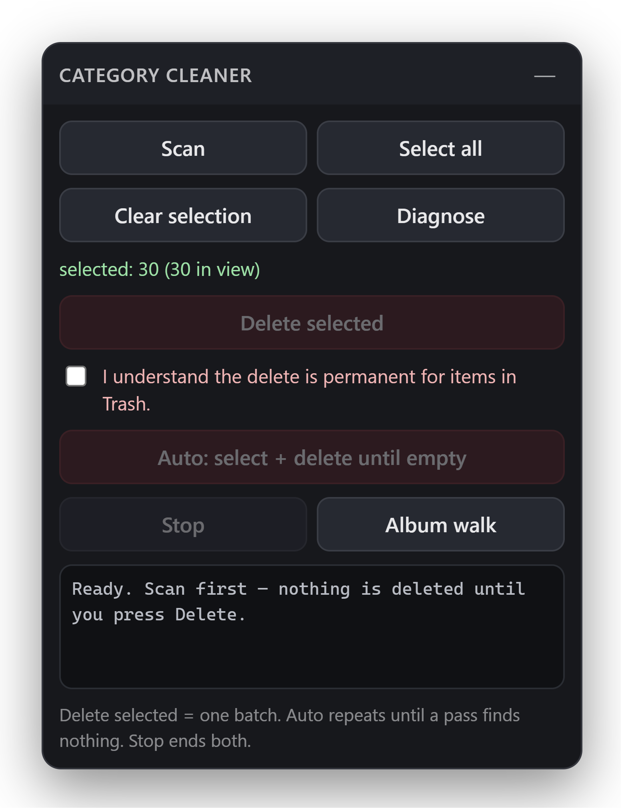
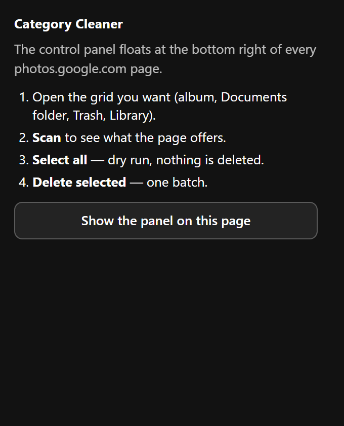

# Google Photos Category Cleaner


An unpacked Chrome extension (Manifest V3) that selects everything on the current Google Photos
grid and deletes it in batches. It drives the page with synthetic clicks — no Google API, no OAuth,
no credentials, nothing leaves the browser.

Google Photos has no "select all" for a whole library, an album or the trash. This adds one.

## What it does

- **Scan** — counts the selectable items on the page, reports whether it found the delete button,
  and names the scroll container it will use. Reads only.
- **Select all** — clicks every tile checkbox, scrolling the grid until Google's own counter stops
  growing. Deletes nothing, so it is a safe dry run: the header shows the count Google computed.
- **Delete selected** — clicks the toolbar delete button and confirms the dialog Google raises. One
  batch.
- **Auto** — repeats select + delete until a pass finds nothing to select.
- **Album walk** — on a page of album tiles, opens each album, selects everything inside, deletes,
  and returns. The queue lives in `sessionStorage`, so it survives the page loads it causes.
- **Diagnose** — dumps every ARIA label, button and dialog the page currently exposes, so a broken
  selector on a new Google Photos build can be fixed from evidence instead of guesswork.

Nothing runs on page load. The panel starts collapsed, and the two destructive buttons stay
disabled until the arming checkbox is ticked.

## Screenshots

The panel with a selection in progress: Google's own counter reads 30, and the delete controls are
still disabled because the arming box is unticked.



The toolbar popup, which only explains the panel:



Both captures come from `test/fixture.html`, a synthetic grid, not a real account. How each image is
taken, and how to retake it after a UI change, is recorded in [docs/screenshots.md](docs/screenshots.md).

## Install

1. Open `chrome://extensions`.
2. Turn on **Developer mode** (top right).
3. Click **Load unpacked** and choose `C:\git\google-photos-bulk`.
4. Open any `photos.google.com` page. The panel appears bottom right; drag it by its header.

That is the only install route Chrome 156 accepts, which is worth knowing before someone tries to
automate it:

- Hand-writing the entry into the profile's `Preferences` is rejected — extension state lives in
  `Secure Preferences` under an HMAC Chrome will not accept from a text editor.
- CDP against the default profile directory is refused outright (Chrome 136+).
- Launching through a junctioned `--user-data-dir` re-enables CDP, and `Extensions.loadUnpacked`
  then installs the extension and reports `location: UNPACKED, status: ENABLED` — but that install
  is scoped to the debugging session and is dropped on the next normal launch. Verified with a
  two-phase restart test; enabling developer mode did not change it.
- `--load-extension` is ignored by branded Chrome builds.

Chrome ties an unpacked extension's ID to the folder's absolute path, so keep this folder where it
is. Moving it means loading it again — and the checkout is still named `google-photos-bulk` because
the ID was already derived from that path when the project was first loaded.

## Use

Work on the narrowest page that contains what you want gone — one album, one Documents folder, the
Trash — rather than the whole library.

1. **Scan**, and check the counts match what you see.
2. **Select all** to confirm the selection lands on the right tiles.
3. Tick the arming box, then **Delete selected** for one batch, or **Auto** for a full purge.
4. **Stop** ends a run mid-way. Selection state lives in the page, so nothing is deleted until the
   delete button is clicked.

Delete from **Trash** is permanent and cannot be undone. Items deleted in the library go to Trash
first, where Google keeps them 30 days (60 for backed-up items).

## How the page model works, and why

Google Photos ships obfuscated class names, so every lookup is role-based (`[role="checkbox"]`,
`[role="dialog"]`) plus a label dictionary in English, Bulgarian, German, French, Spanish,
Portuguese, Russian, Polish and Turkish. Two details came from the live page rather than from docs:

- **The selection header is plain text, not a toolbar.** There is no `[role="toolbar"]` on today's
  selection bar; the count is a `<span>` reading `3 selected`. That string is the only honest
  measure of the selection.
- **The grid is virtualized.** Only ~30–90 tiles exist in the DOM at a time. Their checkboxes are
  removed as you scroll while Google keeps the selection, so the DOM count can *fall* while the real
  selection grows. The script therefore clicks each item **at most once**, keyed by its aria-label: a
  re-rendered tile comes back with `aria-checked="false"`, and clicking it again would deselect it.
  Naive select-all scripts toggle items off that way and delete less than the count they show.

Document albums (`photos.google.com/documents/…`, e.g. Screenshots, Receipts, Social) are automatic
categories. The category itself cannot be deleted; emptying it is what removes it from view, and its
photos are real library photos — deleting them removes them from the library too.

## Verified

`node test/harness.mjs` — 10 checks against a local fixture (`test/fixture.html`) that mimics the
grid with Bulgarian labels: the manifest is accepted by Chrome, the panel injects, 30 tiles are
found, the delete button is located by its Bulgarian label, select-all checks all 30, delete clicks
the toolbar button and confirms the dialog, all 30 tiles leave the grid, and a repeat pass on an
empty grid stops instead of looping.

Against a real signed-in library (`test/live-install.mjs`, `test/inject.mjs`, `test/probe*.js`):
scan found 60 selectable tiles on the photos view; select-all accumulated against Google's own
counter (50 → 68 → 80 → 89 → 98 → 117 → 133 → 162) while the DOM only ever held ~30 tiles; the
delete button resolved to "Move to trash"; Escape cleared the selection back to zero.

Not exercised, deliberately: the delete click on a real account. Deleting is irreversible, and the
fixture already proves the click chain end to end.

## Limits

- Everything is a synthetic click on obfuscated markup. Google can rename a control and break a
  selector; **Diagnose** exists for exactly that, and a run stops instead of clicking blindly.
- Several hundred items per batch is the practical ceiling — Google re-renders the selection header
  on every click — which is why **Auto** exists.
- Album walk is the least tested feature here: the queue and resume logic are written, but no live
  album-list page was available to run it against.
- No permission beyond `photos.google.com` is requested. The toolbar popup only explains the panel.

## Layout

```
manifest.json      MV3 manifest, one content script scoped to photos.google.com
content.js         panel, page model, selection, delete, album walk
popup.html/js      toolbar popup: what the panel is and how to show it
icons/             PNG renders (16/32/48/128) wired into the manifest
docs/icon.svg      icon source of truth; icon-512.png is the README mark
docs/screenshots/  README images; provenance and re-capture notes in screenshots.md
test/fixture.html  fake Google Photos grid with Bulgarian labels
test/harness.mjs   drives the real script against the fixture over CDP
test/capture-docs.mjs  renders the icons and retakes the README screenshots
test/inject.mjs    injects content.js into a live page and runs a probe
test/probe*.js     read-only probes used to learn and re-check the live DOM
test/persist-test.mjs  proves whether an install survives a restart
```

## License

MIT — see [LICENSE](LICENSE).
